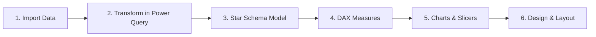

# Online Store Performance Dashboard (Power BI)

**An interactive Power BI dashboard I built during the Advanced Power BI course on Hash Plus — analyzing an online store's sales, profit, products, sales channels, and order cancellations.**

---

## Table of Contents
- [About the Course](#about-the-course)
- [What the Project Contains](#what-the-project-contains)
- [How I Built It](#how-i-built-it)
- [Key Metrics](#key-metrics)
- [Insights](#insights)
- [Dashboard](#dashboard)
- [Skills Demonstrated](#skills-demonstrated)
- [Author](#author)

---

## About the Course

This project is one of the dashboards I built for the **Advanced Power BI** course offered by [Hash Plus](https://hashplus.com), an Arabic online learning platform. It is the next step in my data analysis learning path, after my earlier Power BI projects — [Hospital Patients Dashboard](https://github.com/wajd-cs/hospital-dashboard-powerbi) and [Car Rental Dashboard](https://github.com/wajd-cs/car-rental-dashboard-powerbi) — moving from a single flat table to a star-schema data model with DAX measures.

During the course, I built this dashboard to apply what I learned about data modeling, Power Query, and DAX.

## What the Project Contains

A Power BI report built on a year of online store orders from 2025 (data in Arabic), made of five related tables:

| Table | Rows | Description |
|---|---|---|
| Orders | 10,000 | Order date, quantity, selling price, discount, shipping cost, payment method, sales channel (website or app), order status, delivery days, and customer rating |
| Products | 100 | Product name, category, brand, unit cost, and selling price |
| Customers | 300 | Gender, age, customer type (new or returning), and registration date |
| Cities | 30 | City name and region |
| Calendar | 365 | Date table with year, month, and quarter |

The dashboard includes:

- **3 KPI cards + 1 multi-row card** — net sales, total profit, and number of orders, plus a summary card for customers, average order value, profit margin, cancelled orders, cancellation rate, average rating, and average delivery time
- **5 charts** — monthly sales and cancellation rate (combo chart), sales by category and by city (bar charts), sales by channel (pie chart), and cancellation rate by category (column chart)
- **1 table** — product performance sorted by profit, with losing products highlighted in red
- **4 slicers** — filter the whole report by category, sales channel, month, or region

## How I Built It

**1. Imported the data** from an Excel workbook into Power BI, using a **parameter for the file path** so the report can be pointed to a new file easily.

**2. Transformed it in Power Query**:
- Set the correct data type for every column
- Converted the discount from a whole number to a percentage and renamed it
- Added an **Order Value** column: `Quantity × Selling Price × (1 − Discount %)`
- Added an **Age Group** column to the customers table (18–24, 25–34, 35–44, 45+)
- Generated a **Calendar table** from the first to the last order date, with Arabic month names and quarters

**3. Built a star schema** — the Orders fact table connected to Products, Customers, Cities, and Calendar.

**4. Wrote DAX measures** for every KPI:

| KPI | DAX |
|---|---|
| Net sales | `CALCULATE(SUM('Orders'[Order Value]), 'Orders'[Order Status] <> "Cancelled")` |
| Product cost | `CALCULATE(SUMX('Orders', 'Orders'[Quantity] * RELATED('Products'[Unit Cost])), 'Orders'[Order Status] <> "Cancelled")` |
| Total profit | `[Net sales] - [Product cost]` |
| Profit margin | `DIVIDE([Total profit], [Net sales])` |
| Cancellation rate | `DIVIDE([Cancelled orders], [Number of orders])` |
| Average order value | `DIVIDE([Net sales], CALCULATE([Number of orders], 'Orders'[Order Status] <> "Cancelled"))` |
| Number of customers | `DISTINCTCOUNT('Orders'[Customer ID])` |

**5. Created charts** that answer the main business questions:

| Chart | Type | Question |
|---|---|---|
| Monthly sales & cancellation rate | Combo | How do sales and cancellations change over the year? |
| Sales by category | Bar | Which categories sell the most? |
| Sales by city | Bar | Which cities bring in the most sales? |
| Sales by channel | Pie | Does the website or the app sell more? |
| Cancellation rate by category | Column | Which categories get cancelled the most? |
| Product performance | Table | Which products make a profit, and which lose money? |

**6. Designed the layout** — KPI cards and slicers on top, charts below, with a plum and sand theme and conditional formatting to flag losing products in red.

## Key Metrics

| Metric | Value |
|---|---|
| Number of orders | 10,000 |
| Net sales | ~14.05M SAR |
| Total profit | ~2.69M SAR |
| Profit margin | 19.2% |
| Average order value | ~1,530 SAR |
| Cancelled orders | 815 (8.2%) |
| Customers | 300 |
| Average rating | 4.0 / 5 |
| Average delivery time | 4 days |
| Products / Categories | 100 / 10 |

## Insights

- **Fashion is the top-selling category** (~1.64M SAR, 11.7% of net sales), but **Home Supplies is the most profitable** with ~382K SAR in profit.
- **Electronics sells well but earns little** — ~1.51M SAR in sales with only ~157K SAR in profit, the lowest margin of any category (about 10%).
- **The website and the app are almost equal**, each bringing in about half of net sales (50.5% vs. 49.5%).
- **12 of the 100 products lose money**, which the product table highlights in red.
- **Beauty has the highest cancellation rate** (9.3%), while Fashion has the lowest (6.9%).
- **Sales are steady across the year**, between 1.10M and 1.25M SAR per month, peaking in April.

## Dashboard

## Skills Demonstrated

- **Power Query** — parameters, data types, custom columns, conditional columns, and a generated calendar table
- **Data Modeling** — building a star schema with a fact table and four dimension tables
- **DAX** — writing measures with `CALCULATE`, `SUMX`, `RELATED`, `DIVIDE`, and `DISTINCTCOUNT`, and reusing measures inside other measures
- **Data Visualization** — combo, bar, pie, and column charts, plus conditional formatting in a table
- **Interactive Filtering** — four slicers that filter the entire report through a shared data model
- **Dashboard Design** — organizing KPIs, charts, and filters into one clear, consistent layout
- **Business Thinking** — separating sales from profit to show which products and categories actually make money

## Author

**Wajd Alluhaibi**
Computer Science Student | Data Analysis & Software Development

